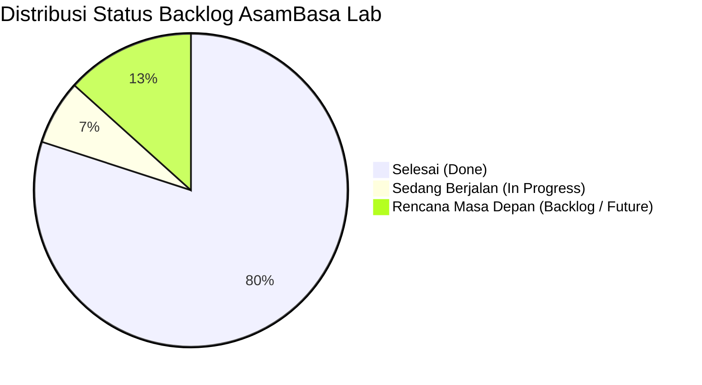

# Dokumen Product & Sprint Backlog
## AsamBasa Lab – Platform Pembelajaran Kimia Interaktif & Laboratorium Virtual

---

### Informasi Dokumen
* **Nama Sistem:** AsamBasa Lab – Product & Sprint Backlog
* **Metodologi:** Agile / Scrum untuk Rekayasa Media Pembelajaran Sains
* **Mata Pelajaran:** Kimia SMA / MA Fase F (Kelas XI)
* **Metode Prioritisasi:** MoSCoW (*Must Have, Should Have, Could Have, Won't Have*)
* **Skala Estimasi:** Story Points (Deret Fibonacci: 1, 2, 3, 5, 8)
* **Status Keseluruhan Proyek:** Sprint 1–4 Tuntas (100% Fitur Inti Selesai Diuji)

---

## 1. Ringkasan Status Sprint & Kemajuan Proyek

| Sprint | Fokus Pembelajaran & Rekayasa | Rentang Waktu | Poin Selesai | Status |
| :--- | :--- | :--- | :--- | :--- |
| **Sprint 1** | Fondasi Arsitektur, Sistem Desain Gelap Sains, & Beranda | 27 Okt 2026 | 21 Poin | ✅ **Done** |
| **Sprint 2** | Pemisahan Modular 7 Bagian & Evaluasi Kuis HOTS | 03 Nov 2026 | 34 Poin | ✅ **Done** |
| **Sprint 3** | Lab Virtual Inkuiri, Spektrum pH, Kalkulator, & Refleksi | 08 Nov 2026 | 29 Poin | ✅ **Done** |
| **Sprint 4** | Autentikasi Multi-Peran, Tautan Hasil, Antrean Server & Guru | 10 Nov 2026 | 40 Poin | ✅ **Done** |
| **Sprint 5** | Ekspor Nilai Spreadsheet & Integrasi REST API Riil | Mendatang | 18 Poin | 📋 *To Do* |

---

## 2. Rincian Product Backlog per Kategori Epik

---

### Epic 1: Fondasi Desain & Navigasi Akademik Modern (Sprint 1 & 2)

| ID | User Story (Kebutuhan Pengguna) | Prioritas | Bobot | Status | Kriteria Penerimaan (Acceptance Criteria) |
| :--- | :--- | :---: | :---: | :---: | :--- |
| **US-01** | **Sebagai siswa**, saya ingin tampilan platform bertema sains modern dan nyaman di mata agar tidak cepat lelah saat belajar mandiri. | Must | 5 | ✅ Done | Desain tema *Deep Dark Science* dengan token CSS, kontras rasio WCAG 2.1 AA, dan tipografi Plus Jakarta Sans. |
| **US-02** | **Sebagai pengguna**, saya ingin navigasi halaman dipisah ke 8 bagian modular via hash URL agar tidak perlu menumpuk scroll panjang. | Must | 8 | ✅ Done | Rute `#/beranda`, `#/teori`, `#/lab`, `#/skala`, `#/kalkulator`, `#/kuis`, `#/refleksi`, `#/login` aktif dan sinkron tombol peramban. |
| **US-03** | **Sebagai siswa**, saya ingin penunjuk rekam jejak (*Breadcrumb*) dan tombol navigasi berurutan (*PageBottomNav*) agar alur belajar tetap runtut. | Should | 3 | ✅ Done | Breadcrumb dinamis muncul di bagian atas tiap modul; tombol Sebelum/Selanjutnya di bagian bawah kartu. |
| **US-04** | **Sebagai siswa/guru**, saya ingin fitur pencarian cepat materi dengan shortcut keyboard `Ctrl+K` agar topik dapat ditemukan secara instan. | Should | 5 | ✅ Done | Dialog modal Command Palette terbuka dengan `Ctrl+K` / `⌘K` dan mengarahkan navigasi langsung ke modul yang dipilih. |

---

### Epic 2: Konten Teori Asam Basa & Peta Pembelajaran (Sprint 1 & 2)

| ID | User Story (Kebutuhan Pengguna) | Prioritas | Bobot | Status | Kriteria Penerimaan (Acceptance Criteria) |
| :--- | :--- | :---: | :---: | :---: | :--- |
| **US-05** | **Sebagai siswa**, saya ingin mempelajari perkembangan teori asam-basa (Arrhenius, Brønsted–Lowry, Lewis) melalui kartu perbandingan interaktif. | Must | 5 | ✅ Done | Modul Teori memuat 3 teori utama, persamaan ionisasi air, pasangan asam-basa konjugasi, dan contoh aplikasi kehidupan nyata. |
| **US-06** | **Sebagai siswa**, saya ingin ringkasan sifat fisik & kimia asam-basa dalam tabel komparatif agar mudah membedakan ciri keduanya. | Should | 3 | ✅ Done | Tersedia tabel sifat rasa (konseptual), korosif/kaustik, konduktivitas listrik, dan respon indikator. |

---

### Epic 3: Laboratorium Virtual & Jurnal Pengamatan Inkuiri (Sprint 3 & 4)

| ID | User Story (Kebutuhan Pengguna) | Prioritas | Bobot | Status | Kriteria Penerimaan (Acceptance Criteria) |
| :--- | :--- | :---: | :---: | :---: | :--- |
| **US-07** | **Sebagai siswa**, saya ingin memilih sampel bahan sehari-hari dan larutan kimia untuk diuji sifat keasamannya di tabung reaksi virtual. | Must | 8 | ✅ Done | Tersedia 8+ sampel kimia (cuka dapur, sabun, HCl, NaOH, air murni, dll.) terbagi dalam kategori bahan sehari-hari dan lab. |
| **US-08** | **Sebagai siswa**, saya ingin meneteskan indikator sintetis (PP, BTB, MO, Lakmus) dan bahan alam (kunyit, kol ungu) untuk melihat reaksi perubahan warna. | Must | 8 | ✅ Done | Animasi cairan SVG berubah warna secara dinamis sesuai trayek pH indikator yang dipilih. |
| **US-09** | **Sebagai siswa**, saya ingin menyimpan hasil pengamatan ke dalam *Buku Jurnal Pengamatan* yang memiliki **ID Percobaan unik**. | Must | 5 | ✅ Done | Tombol *"Simpan ke Jurnal"* mencatat tabel pengamatan dan otomatis menerbitkan ID Percobaan unik (e.g., `EXP-LAB-...`). |
| **US-10** | **Sebagai siswa**, saya ingin menghapus riwayat sesi jurnal lokal saat ingin mengulang praktikum mandiri dari awal. | Could | 2 | ✅ Done | Tombol *"Hapus Semua Riwayat"* mengosongkan tabel pengamatan sesi lokal. |

---

### Epic 4: Visualisasi Sains & Kalkulator pH Kuantitatif (Sprint 3)

| ID | User Story (Kebutuhan Pengguna) | Prioritas | Bobot | Status | Kriteria Penerimaan (Acceptance Criteria) |
| :--- | :--- | :---: | :---: | :---: | :--- |
| **US-11** | **Sebagai siswa**, saya ingin melihat spektrum visual skala pH 0–14 interaktif agar memahami rentang keasaman dan tetapan $K_w = 10^{-14}$. | Must | 5 | ✅ Done | Slider interaktif skala pH 0–14 menampilkan spektrum warna universal dan gradien ion $[H^+]$ vs $[OH^-]$. |
| **US-12** | **Sebagai siswa**, saya ingin menghitung pH asam kuat dan basa kuat secara matematis beserta langkah rincian pengerjaannya. | Must | 5 | ✅ Done | Kalkulator memproses konsentrasi Molaritas, rumus $-\log[H^+]$ atau $14 - \text{pOH}$, dan menyajikan tahapan perhitungannya. |

---

### Epic 5: Evaluasi Formatif Kuis HOTS (Sprint 2 & 4)

| ID | User Story (Kebutuhan Pengguna) | Prioritas | Bobot | Status | Kriteria Penerimaan (Acceptance Criteria) |
| :--- | :--- | :---: | :---: | :---: | :--- |
| **US-13** | **Sebagai siswa**, saya ingin mengerjakan kuis formatif 10 butir soal pilihan ganda HOTS (C3–C5, Opsi A–E) dengan batas waktu tertentu. | Must | 8 | ✅ Done | Kuis memiliki timer mundur, navigator butir soal (1-10), dan opsi jawaban interaktif. |
| **US-14** | **Sebagai siswa**, saya ingin melihat skor akhir, persentase akurasi, dan pembahasan saintifik mendalam pada setiap opsi jawaban. | Must | 5 | ✅ Done | Ringkasan kartu hasil menampilkan skor 0-100 dan pembahasan ilmiah mengapa opsi jawaban benar atau keliru. |
| **US-15** | **Sebagai sistem**, hasil kuis harus memiliki `attemptId` unik yang tersimpan ke penyimpanan lokal dan siap dihubungkan ke akun siswa. | Must | 5 | ✅ Done | Integrasi `quizStorage.ts` menerbitkan ID unik kuis (e.g., `ATT-QUIZ-...`) yang otomatis terdaftar ke repositori percobaan. |

---

### Epic 6: Jurnal Metakognisi & Refleksi Belajar (Sprint 3)

| ID | User Story (Kebutuhan Pengguna) | Prioritas | Bobot | Status | Kriteria Penerimaan (Acceptance Criteria) |
| :--- | :--- | :---: | :---: | :---: | :--- |
| **US-16** | **Sebagai siswa**, saya ingin menuliskan pemahaman materi, kendala belajar, dan komitmen tindak lanjut pada lembar metakognisi. | Should | 3 | ✅ Done | Formulir refleksi mencakup kolom pemahaman konsep, kendala inkuiri, dan rencana belajar lanjutan. |
| **US-17** | **Sebagai siswa**, saya ingin mencetak lembar kerja refleksi ke format file PDF untuk diserahkan sebagai portofolio belajar mandiri. | Should | 3 | ✅ Done | Tombol cetak memicu dialog *Print to PDF* peramban dengan layout styling dokumen akademik bersih. |

---

### Epic 7: Autentikasi Pengguna & Penautan Hasil Percobaan (Sprint 4)

| ID | User Story (Kebutuhan Pengguna) | Prioritas | Bobot | Status | Kriteria Penerimaan (Acceptance Criteria) |
| :--- | :--- | :---: | :---: | :---: | :--- |
| **US-18** | **Sebagai pengguna**, saya ingin dapat masuk sebagai Siswa atau Guru, serta mendaftar akun baru dengan NIS / NIP yang jelas. | Must | 5 | ✅ Done | Formulir login/register mendukung peran `siswa` (dengan NIS & Kelas) dan `guru` (dengan NIP & Mapel). |
| **US-19** | **Sebagai penguji/pengguna**, saya ingin tombol *1-Click Demo Login* (Budi, Nadia, Bu Sri) agar dapat mencoba seluruh alur tanpa mengetik berulang. | Should | 3 | ✅ Done | Tombol demo cepat tersedia untuk 2 siswa dan 1 guru pembimbing kimia. |
| **US-20** | **Sebagai siswa**, saya ingin memilih hasil percobaan lokal yang belum bertuan dan menautkannya ke akun saya dengan **ID Percobaan yang tetap dipertahankan**. | Must | 8 | ✅ Done | Tab *"Pilih & Tautkan"* menampilkan checklist; pengaitan menetapkan nama pemilik tanpa mengubah sedikitpun ID percobaan unik. |

---

### Epic 8: Antrean Pengiriman Server & Evaluasi Guru (Sprint 4)

| ID | User Story (Kebutuhan Pengguna) | Prioritas | Bobot | Status | Kriteria Penerimaan (Acceptance Criteria) |
| :--- | :--- | :---: | :---: | :---: | :--- |
| **US-21** | **Sebagai siswa**, saya ingin mengantrekan percobaan dan mengirimkannya ke server dengan respons konfirmasi penerimaan server yang jelas. | Must | 8 | ✅ Done | Tab Antrean memuat ID Percobaan, Pemilik, dan tombol *"Kirim ke Server"* dengan balasan simulasi HTTP 200 OK & tiket ACK. |
| **US-22** | **Sebagai siswa**, saya ingin memantau konsol log server secara transparan untuk memverifikasi stempel waktu pengiriman tugas saya. | Should | 3 | ✅ Done | Tampilan terminal log konsol server menampilkan rincian transaksi pengiriman dan pembacaan tugas. |
| **US-23** | **Sebagai guru**, saya ingin melihat dashboard evaluasi kelas yang merangkum seluruh kiriman percobaan siswa beserta metrik statistiknya. | Must | 8 | ✅ Done | Dashboard Guru menyajikan 4 metrik ringkasan, filter nama siswa, filter status review, dan pencarian cepat ID Percobaan. |
| **US-24** | **Sebagai guru**, saya ingin membaca rincian pengujian sains siswa dan memberikan umpan balik kualitatif serta predikat penilaian. | Must | 8 | ✅ Done | Modal evaluasi guru memuat form predikat (Sangat Baik / Baik / Perlu Perbaikan), textarea umpan balik, dan tombol simpan. |
| **US-25** | **Sebagai siswa**, saya ingin membaca catatan pembimbing dan predikat evaluasi yang diberikan guru langsung di halaman riwayat akun saya. | Must | 5 | ✅ Done | Kartu riwayat siswa menampilkan kotak khusus berlatar hijau zamrud berisi catatan kualitatif dari guru. |

---

### Epic 9: Peningkatan Skalabilitas & Roadmap Masa Depan (Sprint 5 - Backlog)

| ID | User Story (Kebutuhan Pengguna) | Prioritas | Bobot | Status | Kriteria Penerimaan (Acceptance Criteria) |
| :--- | :--- | :---: | :---: | :---: | :--- |
| **US-26** | **Sebagai pengembang**, saya ingin endpoint sinkronisasi server terhubung ke REST API riil di cloud (Node.js/Express atau Firebase). | Could | 8 | 📋 To Do | Fungsi `sendQueueToServer()` melakukan `fetch()` jaringan riil ke endpoint `/api/v1/sync`. |
| **US-27** | **Sebagai guru**, saya ingin mengunduh rekapitulasi nilai dan pengamatan seluruh siswa ke format spreadsheet Microsoft Excel (.xlsx / .csv). | Could | 5 | 📋 To Do | Tombol *"Ekspor Buku Nilai"* menghasilkan file spreadsheet rekapitulasi nilai kelas. |
| **US-28** | **Sebagai siswa**, saya ingin menerima lencana notifikasi di header navbar saat guru telah memeriksa dan menilai tugas saya. | Could | 3 | 📋 To Do | Indikator badge merah/oranye muncul di ikon lonceng akun jika terdapat review guru baru. |
| **US-29** | **Sebagai guru**, saya ingin membuat dan mengedit bank soal kuis baru secara dinamis langsung dari antarmuka guru. | Won't (v2) | 8 | 📋 Backlog | Formulir pembuat soal kuis HOTS dinamis untuk ujian akhir semester. |

---

## 3. Matriks Keterlacakan Kebutuhan (Traceability Matrix)

| Modul Pembelajaran | File Implementasi Utama | User Stories yang Ditangani |
| :--- | :--- | :--- |
| **Sistem Navigasi & Shell** | `src/types/navigation.ts`, `src/components/Navbar.tsx`, `src/components/Breadcrumb.tsx` | US-01, US-02, US-03, US-04 |
| **Materi Teori Asam Basa** | `src/components/TheorySection.tsx`, `src/components/TopicCards.tsx` | US-05, US-06 |
| **Laboratorium Inkuiri Virtual** | `src/components/VirtualLab.tsx`, `src/data/chemistryData.ts` | US-07, US-08, US-09, US-10 |
| **Kuantitatif & Skala pH** | `src/components/PhScaleSection.tsx`, `src/components/PhCalculator.tsx` | US-11, US-12 |
| **Evaluasi Kuis HOTS** | `src/components/QuizSection.tsx`, `src/services/quizStorage.ts`, `src/data/module1QuizData.ts` | US-13, US-14, US-15 |
| **Refleksi Metakognisi** | `src/components/ReflectionSection.tsx` | US-16, US-17 |
| **Autentikasi & Tautan Hasil** | `src/components/LoginPortal.tsx`, `src/services/authStorage.ts`, `src/types/auth.ts` | US-18, US-19, US-20 |
| **Antrean Server & Evaluasi Guru** | `src/components/LoginPortal.tsx`, `src/components/LoginPortal.css` | US-21, US-22, US-23, US-24, US-25 |

