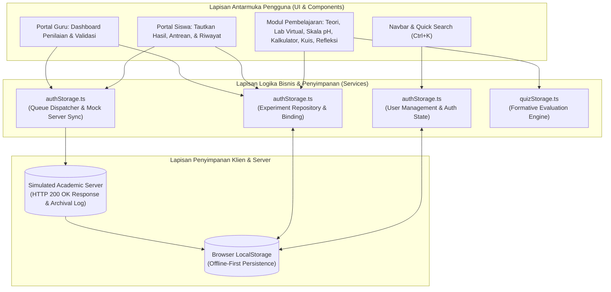
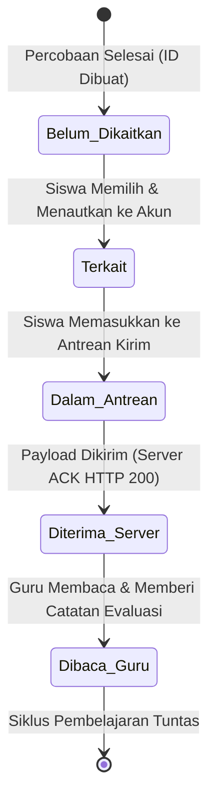

# Dokumen Desain Teknis (Technical Design Document)
## AsamBasa Lab – Modern Academic Learning Platform & Inquiry Virtual Lab

---

### Informasi Dokumen
* **Nama Sistem:** AsamBasa Lab – Platform Pembelajaran Kimia Interaktif & Laboratorium Inkuiri Virtual
* **Mata Pelajaran:** Kimia SMA / MA (Fase F - Kelas XI)
* **Gaya Antarmuka:** *Modern Academic Learning Platform* (Sintesis Google Classroom, Moodle LMS, dan Dashboard EdTech Modern)
* **Tech Stack Utama:** React 19, TypeScript, Vite, CSS Design Tokens, Web Storage API (LocalStorage + Memory Fallback)
* **Target Pengguna:** Siswa Kelas XI, Guru Pengampu Mata Pelajaran Kimia, Laboran Sains
* **Status Dokumen:** Rilis Arsitektur Sistem Terpadu (Versi 2.0)

---

## 1. Pendahuluan & Filosofi Desain

### 1.1 Visi Platform
**AsamBasa Lab** dirancang sebagai media pembelajaran interaktif berbasis web yang memadukan keunggulan tiga platform pembelajaran digital terkemuka:
1. **Google Classroom:** Kesederhanaan alur kerja, kemudahan penyerahan tugas (*submission stream*), kartu materi terstruktur, dan komunikasi umpan balik dua arah antara siswa dan guru secara langsung.
2. **Moodle LMS:** Ketelitian hierarki akademik, pelacakan kompetensi berbasis inkuiri terbimbing, buku catatan jurnal praktikum (*inquiry log*), serta rubrik penilaian formatif yang transparan.
3. **Modern EdTech Dashboard:** Pengalaman visual pembelajaran yang cerah, bersih, ramah siswa, dan modern dengan gaya Bright Science Learning. Antarmuka menggunakan latar belakang terang, kartu dengan permukaan putih, aksen warna kimia yang lembut, tipografi akademik berketerbacaan tinggi, ilustrasi edukatif, serta komponen interaktif dengan hierarki visual yang jelas. Gunakan Plus Jakarta Sans untuk teks utama dan JetBrains Mono secara terbatas untuk angka pH, konsentrasi larutan, serta ID eksperimen.

### 1.2 Prinsip Desain Edukatif
* **Cognitive Load Reduction:** Informasi disajikan secara berjenjang melalui 8 modul terpisah (*hash-routed views*), navigasi rekam jejak (*Breadcrumb*), dan navigasi halaman berurutan (*PageBottomNav*) agar siswa tidak kewalahan.
* **Preservation of Experiment Identity:** Setiap aktivitas eksperimen virtual dan pengerjaan kuis memiliki **ID Percobaan yang kekal (immutable)**, memastikan integritas data ilmiah saat ditautkan ke akun pengguna maupun dikirimkan ke server.
* **Transparent Feedback Loop:** Guru dapat membaca seluruh data kuantitatif dan kualitatif siswa, kemudian menyematkan catatan pembimbing saintifik yang langsung tampil di dashboard siswa.
* **Inclusive & Accessible:** Antarmuka dirancang dengan warna cerah yang tetap memiliki kontras memadai, navigasi keyboard, indikator fokus yang terlihat, dukungan screen reader, serta atribut ARIA semantik. WCAG 2.1 AA digunakan sebagai target standar aksesibilitas yang harus diverifikasi melalui pengujian.

---

## 2. Arsitektur Sistem & Aliran Data

Sistem mengadopsi arsitektur *Client-Centric Progressive Learning Architecture* dengan lapisan abstraksi layanan (*service layer*) yang siap dialihkan ke backend API RESTful/GraphQL tanpa mengubah struktur antarmuka pengguna.



---

## 3. Siklus Hidup Percobaan & Protokol Server (Experiment Lifecycle)

Setiap pengujian laboratorium virtual atau pengerjaan evaluasi kuis melalui 5 tahapan status yang terdefinisi dengan ketat:



### 3.1 Spesifikasi Status Aliran Data

| Status | Kode Status | Keterangan Teknis | Hak Akses & Visibilitas |
| :--- | :--- | :--- | :--- |
| **Belum Dikaitkan** | `belum_dikaitkan` | Hasil percobaan dibuat saat mode tamu atau belum diklaim. Memiliki `id` unik, tetapi `ownerId = null`. | Muncul di tab "Pilih & Tautkan Hasil". |
| **Terkait Akun** | `terkait` | Telah dikaitkan ke siswa login. **ID percobaan asli dipertahankan**, `ownerName` dan `ownerClass` diisi. | Tampil di "Hasil Saya", siap dimasukkan ke antrean. |
| **Dalam Antrean** | `dalam_antrean` | Siap dikirim ke server pendidikan. Disertai stempel waktu `queuedAt`. | Tampil di tab antrean pengiriman siswa & guru. |
| **Diterima Server** | `diterima_server` | Server telah menerima payload kiriman secara utuh. Diterbitkan tiket bukti terima `serverAckId` dan respons HTTP 200. | Tampil di Dashboard Guru (status: *Perlu Diperiksa*). |
| **Dibaca Guru** | `dibaca_guru` | Guru telah membuka data ilmiah siswa, mengisi `teacherFeedback`, dan memberikan predikat evaluasi. | Dibaca oleh siswa di portal hasil pribadinya. |

---

## 4. Struktur Data & Kontrak Antarmuka (Data Schemas)

### 4.1 Entitas Akun Pengguna (`UserAccount`)
Mendukung pemisahan peran (*Role-Based Access Control / RBAC*) antara siswa dan tenaga pendidik.

```typescript
export type UserRole = 'siswa' | 'guru';

export interface UserAccount {
  id: string;                 // Identifier unik (e.g., 'usr_siswa_budi')
  username: string;           // Kredensial unik login
  password?: string;          // Kredensial keamanan
  fullName: string;           // Nama lengkap siswa/guru
  role: UserRole;             // 'siswa' | 'guru'
  identifierNumber: string;   // Nomor Induk Siswa (NIS) atau NIP Guru
  schoolClass?: string;       // Rombel/Kelas untuk Siswa (e.g., 'XI MIPA 1')
  subject?: string;           // Bidang keahlian untuk Guru (e.g., 'Kimia SMA')
  avatarColor: string;        // Aksen warna profil akademik
}
```

### 4.2 Entitas Percobaan & Hasil Belajar (`ExperimentItem`)
Struktur data tunggal yang menyatukan hasil eksperimen virtual lab dan kuis formatif dengan jaminan **ID Percobaan yang kekal**.

```typescript
export type ExperimentType = 'lab_simulasi' | 'kuis_evaluasi';

export interface ExperimentDetails {
  // Eksperimen Lab Virtual
  sampleName?: string;        // Nama larutan sampel (e.g., 'Asam Cuka Dapur')
  indicatorName?: string;     // Indikator yang dipakai (e.g., 'Lakmus Biru')
  ph?: number;                // Estimasi nilai pH larutan
  colorName?: string;         // Deskripsi perubahan warna teramati
  colorHex?: string;          // Kode heksadesimal warna pengamatan
  natureLabel?: string;       // Sifat larutan (Asam Kuat, Asam Lemah, Netral, dll.)
  
  // Evaluasi Kuis Formatif
  score?: number;             // Skor perolehan (skala 0 - 100)
  correctCount?: number;      // Jumlah jawaban benar
  wrongCount?: number;        // Jumlah jawaban salah
  totalQuestions?: number;    // Total butir soal HOTS
  durationSeconds?: number;   // Waktu pengerjaan dalam detik
  moduleTitle?: string;       // Judul modul kuis
}

export interface ExperimentItem {
  id: string;                 // ID Percobaan UNIK & KEKAL (e.g., 'EXP-LAB-CH3COOH-8291')
  experimentType: ExperimentType;
  title: string;
  summary: string;
  createdAt: string;          // Stempel waktu ISO-8601 pembuatan
  
  // Data Kepemilikan (Ditetapkan saat penautan hasil)
  ownerId: string | null;
  ownerName: string | null;
  ownerRole: UserRole | null;
  ownerClass?: string;
  
  // Status Aliran Data
  status: 'belum_dikaitkan' | 'terkait' | 'dalam_antrean' | 'diterima_server' | 'dibaca_guru';
  queuedAt?: string;
  serverReceivedAt?: string;
  serverAckId?: string;       // Tiket konfirmasi server (e.g., 'SRV-ACK-9021')
  
  // Evaluasi & Umpan Balik Guru (Google Classroom / Moodle Style)
  teacherReadAt?: string;
  teacherName?: string;
  teacherRating?: 'Sangat Baik' | 'Baik' | 'Perlu Perbaikan';
  teacherFeedback?: string;   // Catatan kualitatif dari guru
  
  details: ExperimentDetails;
}
```

### 4.3 Entitas Transaksi & Log Server (`ServerSyncLog`)
Menyediakan bukti forensik komunikasi jaringan antara klien dan server.

```typescript
export interface ServerSyncLog {
  id: string;
  timestamp: string;
  experimentId: string;       // ID Percobaan yang diverifikasi server
  ownerName: string;          // Nama pemilik terdaftar pada tiket
  status: 'SUCCESS' | 'QUEUED' | 'READ';
  httpCode: number;           // 200 OK
  message: string;            // Rincian pesan konfirmasi transaksi
}
```

---

## 5. Dekomposisi Komponen & Hierarki Halaman

Antarmuka disusun mengikuti pola modular berbasis komponen independen di dalam direktori `src/components/`.

```
src/
├── components/
│   ├── Navbar.tsx             # Header sticky, 8 navigasi utama, badge akun, trigger Ctrl+K
│   ├── Breadcrumb.tsx         # Penunjuk rekam jejak posisi modul belajar
│   ├── PageBottomNav.tsx      # Navigasi cepat maju/mundur antar-modul
│   ├── SearchModal.tsx        # Dialog pencarian materi global (Command Palette)
│   ├── HeroSection.tsx        # Sambutan gerbang inkuiri & CTA utama
│   ├── TopicCards.tsx         # Tiga kartu modul pengantar kimia
│   ├── TheorySection.tsx      # Modul 1: Teori Arrhenius, Brønsted–Lowry, & Lewis
│   ├── VirtualLab.tsx         # Modul 2: Lab Virtual, animasi tabung SVG, & jurnal inkuiri
│   ├── PhScaleSection.tsx     # Modul 3: Visualisasi spektrum derajat keasaman 0–14
│   ├── PhCalculator.tsx       # Modul 4: Kalkulator matematis pH asam & basa kuat
│   ├── QuizSection.tsx        # Modul 5: Evaluasi formatif 10 soal HOTS ber-timer
│   ├── ReflectionSection.tsx  # Modul 6: Jurnal metakognisi & generator cetak PDF
│   ├── LoginPortal.tsx        # Modul 7: Portal Akun, Tautan Hasil, Antrean Server & Guru
│   └── Footer.tsx             # Penutup halaman dengan direktori peta modul
├── services/
│   ├── authStorage.ts         # Layanan auth, binding hasil, antrean server, evaluasi guru
│   └── quizStorage.ts         # Layanan penyimpanan riwayat kuis & validasi local storage
└── types/
    ├── auth.ts                # Kontrak data autentikasi, antrean, dan percobaan
    ├── navigation.ts          # Metadata rute 8 modul pembelajaran
    ├── chemistry.ts           # Definisi sampel kimia & indikator asam-basa
    └── quiz.ts                # Definisi butir soal HOTS & opsi jawaban
```

---

## 6. Desain Pengalaman Pengguna (Modern Academic UX)

### 6.1 Antarmuka Portal Siswa (Student Experience)
1. **Pilih & Tautkan Hasil ke Akun:**
   * Siswa dapat melihat daftar seluruh hasil eksperimen yang belum di-klaim (*unlinked*).
   * Fitur multi-select checkbox dengan aksi massal *"Kaitkan ke Akun Saya"*.
   * Sistem menjamin **ID Percobaan tetap utuh** sehingga rekam jejak inkuiri tidak hilang.
2. **Antrean Pengiriman Server (Sync Queue):**
   * Kartu tabel menyajikan data lengkap: ID Percobaan, Pemilik, Ringkasan Hasil Kimia, dan Status.
   * Tombol aksi *"🚀 Kirim Antrean ke Server"* dilengkapi simulasi latensi jaringan, pembaruan status `HTTP 200 OK`, serta penerbitan stempel bukti terima.
3. **Hasil Saya & Umpan Balik Guru (Feedback Stream):**
   * Kartu pengamatan menyajikan hasil uji larutan secara visual (lingkaran warna reaksi kimia, nilai pH, dan kategori asam-basa).
   * Kotak apresiasi menggunakan latar hijau mint yang lembut dengan teks berkontras tinggi untuk menampilkan Catatan Evaluasi Guru dan predikat nilai setelah guru memberikan penilaian. Desain dibuat ringan, bersih, dan mudah dibaca.

### 6.2 Dashboard Evaluasi Guru (Teacher Grading Hub)
1. **Statistik Kelas Terpadu:**
   * Kartu metrik: *Total Percobaan Siswa Masuk*, *Perlu Diperiksa & Dinilai*, *Telah Dibaca & Diberi Feedback*, dan *Antrean Menunggu*.
2. **Filter & Pencarian Lanjutan:**
   * Penyaringan berdasarkan nama siswa/pemilik spesifik.
   * Penyaringan status (*Perlu Review* vs *Sudah Dinilai*).
   * Kotak pencarian pencocokan instan berdasarkan ID Percobaan atau kata kunci judul larutan.
3. **Modal Form Evaluasi Interaktif:**
   * Guru membaca ringkasan data eksperimen saintifik siswa (sampel, indikator, warna, pH, akurasi jawaban kuis).
   * Pemilihan predikat: *Sangat Baik (A)*, *Baik (B)*, atau *Perlu Perbaikan (C)*.
   * Kolom catatan pembimbing dengan textarea yang fleksibel.
   * Tombol *"✅ Simpan & Tandai Telah Dibaca"* yang secara reaktif memperbarui status server dan akun siswa.

---

## 7. Sistem Desain & Token Visual (Bright Science Learning)

Platform menerapkan sistem desain **Bright Science Learning Theme** dengan pendekatan visual yang cerah, modern, bersih, dan ramah bagi siswa SMA/MA kelas XI.

Desain mengutamakan kenyamanan membaca, hierarki visual yang jelas, penggunaan warna yang konsisten, serta ilustrasi yang mendukung pemahaman konsep kimia.

### 7.1 Palet Warna Utama

```css
:root {
  /* Latar Belakang */
  --bg-body: #F8FAFC;
  --bg-surface: #FFFFFF;
  --bg-surface-elevated: #F1F5F9;
  --bg-surface-hover: #EAF4FF;

  /* Garis Batas */
  --border-subtle: #E2E8F0;
  --border-medium: #CBD5E1;
  --border-strong: #94A3B8;

  /* Tipografi */
  --text-primary: #172554;
  --text-secondary: #475569;
  --text-muted: #64748B;
  --text-on-accent: #FFFFFF;

  /* Identitas AsamBasa Lab */
  --accent-primary: #0891B2;
  --accent-primary-hover: #0E7490;
  --accent-secondary: #3B82F6;

  /* Warna Kimia */
  --acid-red: #E85D75;
  --base-blue: #3B82F6;
  --neutral-green: #10B981;
  --accent-cyan: #06B6D4;
  --accent-amber: #D97706;
  --role-teacher-purple: #7C3AED;

  /* Permukaan Kartu Modul */
  --module-one-bg: #FFF1F2;
  --module-two-bg: #ECFEFF;
  --module-three-bg: #EFF6FF;

  /* Status */
  --status-success: #15803D;
  --status-warning: #B45309;
  --status-error: #B91C1C;
  --status-info: #0369A1;

  /* Bayangan */
  --shadow-card: 0 4px 16px rgba(15, 23, 42, 0.05);
  --shadow-card-hover: 0 8px 24px rgba(15, 23, 42, 0.09);

  /* Radius */
  --radius-sm: 8px;
  --radius-md: 14px;
  --radius-lg: 20px;
  --radius-xl: 24px;
}
```

### 7.2 Pedoman Penggunaan Warna

1. Gunakan warna putih dan abu-abu sangat muda sebagai latar utama halaman.
2. Gunakan cyan dan biru sebagai warna identitas utama AsamBasa Lab.
3. Gunakan coral atau merah lembut untuk merepresentasikan larutan asam.
4. Gunakan biru untuk merepresentasikan larutan basa.
5. Gunakan hijau untuk merepresentasikan kondisi netral dan status keberhasilan.
6. Gunakan ungu sebagai aksen khusus fitur guru.
7. Gunakan warna amber untuk peringatan dan informasi yang membutuhkan perhatian.
8. Gunakan warna teks biru tua atau slate gelap untuk menjaga keterbacaan.
9. Hindari penggunaan gradien yang terlalu kuat, warna neon berlebihan, dan dekorasi yang mengganggu konsentrasi.

### 7.3 Tipografi

- Font utama: Plus Jakarta Sans.
- Font angka dan data teknis: JetBrains Mono.
- Judul halaman: tegas, jelas, dan memiliki hierarki ukuran yang konsisten.
- Isi materi: nyaman dibaca dengan ukuran yang sesuai untuk perangkat desktop dan seluler.
- Angka pH, konsentrasi ion, dan hasil perhitungan menggunakan tipografi monospaced apabila diperlukan.

### 7.4 Gaya Komponen Antarmuka

- Navbar menggunakan latar putih, teks gelap, dan aksen cyan atau biru pada menu aktif.
- Hero Section menggunakan komposisi ringan dengan ilustrasi sains, latar lembut, dan tombol CTA yang mudah dikenali.
- Topic Cards menggunakan permukaan putih dengan ilustrasi atau aksen warna berbeda untuk setiap modul.
- Kartu materi memiliki sudut membulat, bayangan lembut, dan efek hover yang tidak berlebihan.
- Tombol utama menggunakan warna cyan atau biru dengan kontras teks yang memadai.
- Simulasi laboratorium menggunakan warna indikator yang representatif dan dapat dibedakan.
- Dashboard guru dan portal siswa menggunakan kartu informasi yang bersih dan mudah dipindai.

### 7.5 Prinsip Responsivitas dan Aksesibilitas

- Desktop, tablet, dan smartphone harus memiliki tata letak yang sesuai dengan ukuran layar.
- Kontras teks dan latar belakang harus memenuhi rasio WCAG 2.1 AA.
- Warna tidak boleh menjadi satu-satunya penanda informasi; gunakan teks, ikon, atau label pendukung.
- Semua tombol dan tautan harus dapat diakses menggunakan keyboard.
- Indikator fokus harus terlihat jelas.
- Hindari animasi berlebihan dan hormati preferensi reduced motion.
- Pastikan komponen interaktif memiliki label aksesibilitas yang sesuai.

## 8. Keamanan, Validasi, & Aksesibilitas

1. **Integritas ID Percobaan (Immutability Guarantee):**
   * Fungsi `linkExperimentsToAccount()` secara tegas melarang perubahan properti `item.id`.
   * Hanya atribut `ownerId`, `ownerName`, `ownerRole`, `ownerClass`, dan `status` yang diperbarui saat kepemilikan dialihkan.
2. **Penyimpanan Tahan Kegagalan (Resilient Storage Fallback):**
   * Seluruh pembacaan dan penulisan `localStorage` dibungkus dalam blok proteksi `try-catch`.
   * Apabila peramban berada dalam mode *Private Browsing* atau kuota penyimpanan penuh, sistem secara transparan beralih ke struktur penyimpanan berbasis memori (`Map<string, string>`).
3. **Kepatuhan Aksesibilitas:**
   * Seluruh elemen tombol non-teks memiliki atribut `aria-label`.
   * Komponen dialog modal menerapkan `role="dialog"` dan `aria-modal="true"`.
   * Notifikasi aksi menyediakan tombol tutup manual dan timer otomatis pembersihan memori.

---

## 9. Rencana Ekstensi Masa Depan (Future Roadmap)

1. **Integrasi Backend REST API Riil:**
   * Mengganti fungsi `sendQueueToServer()` di `src/services/authStorage.ts` dengan pemanggilan `fetch('/api/v1/experiments/sync')` tanpa mengubah antarmuka React.
2. **Ekspor Nilai Kelas (Gradebook Export):**
   * Fitur bagi Guru untuk mengunduh rekapitulasi penilaian seluruh siswa dalam format spreadsheet (.xlsx / .csv).
3. **Sistem Notifikasi Push Akademik:**
   * Memberikan lencana notifikasi di navbar siswa saat guru telah memberikan catatan pada percobaan tertentu.

