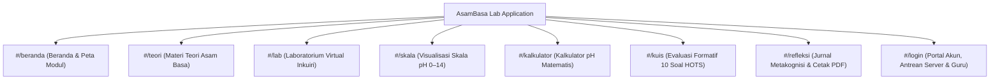

# Dokumen Alur Pengguna (User Flow Document)
## AsamBasa Lab – Modern Academic Learning Platform & Inquiry Virtual Lab

---

### Informasi Dokumen
* **Nama Sistem:** AsamBasa Lab – Alur Pengalaman Pengguna Platform Pembelajaran Asam Basa
* **Mata Pelajaran:** Kimia SMA / MA Fase F (Kelas XI)
* **Pendekatan Pedagogis:** Inkuiri Terbimbing (*Guided Inquiry Learning*) & Siklus Belajar Formatik Dua Arah
* **Persona Pengguna:** 
  1. **Siswa (Student):** Mengakses materi, melakukan eksperimen virtual, mengerjakan kuis, menautkan hasil, mengantrekan ke server, dan membaca evaluasi guru.
  2. **Guru (Teacher):** Memantau metrik kelas, memeriksa kiriman percobaan siswa di server, membaca data kimia terperinci, dan memberikan umpan balik evaluasi.
* **Status Dokumen:** Versi Resmi Terintegrasi (Versi 2.0)

---

## 1. Peta Navigasi Global Platform (Sitemap & Hash Routing)

Aplikasi mengadopsi navigasi berbasis *URL Hash Routing* yang memastikan pengguna dapat langsung mengakses bagian manapun dan menggunakan tombol navigasi peramban (*Back/Forward*) secara alami.

---

## 2. Alur Pengguna Siswa (Student User Flow)

### 2.1 Ringkasan Alur Perjalanan Siswa
flowchart TD
    A([Siswa Membuka AsamBasa Lab]) --> B[Beranda]
    B --> C{Memilih Aktivitas}

    C --> D[Materi Teori]
    C --> E[Lab Virtual]
    C --> F[Skala pH]
    C --> G[Kalkulator pH]
    C --> H[Kuis]
    C --> I[Refleksi]

    D --> J[Memahami Konsep Asam-Basa]
    J --> C

    E --> K[Orientasi Masalah]
    K --> L[Merumuskan Pertanyaan]
    L --> M[Menyusun Hipotesis]
    M --> N[Melakukan Percobaan Virtual]
    N --> O[Mengamati dan Mengumpulkan Data]
    O --> P[Menganalisis Hasil]
    P --> Q[Menarik Kesimpulan]
    Q --> R[Menyimpan Hasil Pengamatan]

    F --> C
    G --> C

    H --> S[Mengerjakan Soal Evaluasi]
    S --> T[Mendapatkan Skor dan Pembahasan]

    R --> U{Ingin Menyimpan ke Akun?}
    T --> U

    U -->|Tidak| V[Hasil Tersimpan Lokal]
    U -->|Ya| W[Login atau Daftar]
    W --> X[Mengaitkan Hasil ke Akun]
    X --> Y[Mengirim Hasil Jika Fitur Tersedia]
    Y --> Z[Melihat Riwayat dan Umpan Balik Guru]

    I --> AA[Menulis Refleksi Pembelajaran]
    AA --> V

### 2.2 Rincian Tahapan Alur Siswa

#### Alur S-1: Eksplorasi Inkuiri di Lab Virtual (`#/lab`)

1. Siswa membuka menu Laboratorium Virtual.
2. Sistem menampilkan pengantar praktikum dan tujuan pembelajaran.
3. Siswa mengamati permasalahan kontekstual mengenai sifat asam dan basa.
4. Siswa merumuskan pertanyaan berdasarkan permasalahan yang disajikan.
5. Siswa menyusun hipotesis atau dugaan sementara.
6. Siswa memilih kategori larutan:
   - Bahan sehari-hari, seperti asam cuka, air jeruk, dan sabun.
   - Larutan laboratorium, seperti HCl dan NaOH.
7. Siswa memilih indikator asam-basa yang akan digunakan.
8. Siswa melakukan percobaan virtual melalui interaksi yang tersedia.
9. Sistem menampilkan animasi dan perubahan warna indikator.
10. Siswa mengamati serta mencatat hasil percobaan.
11. Sistem menampilkan data pengamatan berupa warna indikator, estimasi pH, dan sifat larutan.
12. Siswa menganalisis data dan membandingkannya dengan hipotesis awal.
13. Siswa menyusun kesimpulan berdasarkan hasil percobaan.
14. Siswa menyimpan hasil pengamatan ke jurnal.
15. Sistem menyimpan data percobaan beserta ID unik jika fitur penyimpanan berhasil.

#### Alur S-2: Pengerjaan Kuis Formatif HOTS (`#/kuis`)
1. Siswa membuka menu Kuis dan Skor.
2. Menekan tombol *"Mulai Kuis Modul 1"*.
3. Timer countdown waktu pengerjaan otomatis berjalan.
4. Siswa menjawab 10 butir soal HOTS (analisis konsep Arrhenius, Brønsted–Lowry, Lewis, dan indikator).
5. Pada akhir kuis, siswa menekan *"Kirim Seluruh Jawaban"*.
6. Layar menampilkan skor akhir, jumlah benar/salah, serta pembahasan ilmiah komprehensif pada setiap nomor soal.
7. Sistem menerbitkan **ID Percobaan Kuis** (misal: `ATT-QUIZ-M1-4820`) dan menyimpannya ke repositori akun.

#### Alur S-3: Penautan Hasil ke Akun (`#/login` $\rightarrow$ Tab Tautkan)
1. Siswa membuka halaman Portal Akun (`#/login`).
2. Masuk menggunakan akun terdaftar atau memilih tombol akses cepat demo (**Budi Pratama** / **Nadia Revalina**).
3. Masuk ke tab **"🔗 Pilih & Tautkan Hasil ke Akun"**.
4. Siswa melihat daftar seluruh hasil pengujian yang belum memiliki pemilik.
5. Siswa memilih hasil yang ingin diklaim menggunakan kotak centang (*checkbox*) atau tombol *"Pilih Semua"*.
6. Siswa menekan tombol **"Kaitkan Hasil Terpilih ke Akun Saya"**:
   * **Ketentuan Kritis:** **ID Percobaan (`item.id`) tetap dipertahankan secara utuh**.
   * Identitas pemilik (`ownerName`, `ownerClass`, `ownerId`) diperbarui ke akun siswa yang sedang aktif.
   * Status berubah menjadi `terkait`.

#### Alur S-4: Pengantrean & Pengiriman ke Server (`#/login` $\rightarrow$ Tab Antrean)
1. Siswa membuka tab **"📤 Antrean Kirim ke Server"**.
2. Memeriksa daftar antrean yang memuat rincian: **ID Percobaan**, **Pemilik**, **Jenis Percobaan**, dan **Ringkasan Hasil**.
3. Siswa menekan tombol **"🚀 Kirim Antrean ke Server"**:
   * Tombol menampilkan animasi indikator proses (*spinner*): *"Mengirim ke Server..."*.
   * Terjadi simulasi transmisi data jaringan.
   * Server memvalidasi bahwa `ID Percobaan` dan `Pemilik` sah.
   * Sistem menjalankan simulasi proses pengiriman data dan menampilkan
status konfirmasi simulasi. Status ini tidak menunjukkan bahwa data
telah diterima oleh server eksternal yang sesungguhnya. (misal: `SRV-ACK-9021`).
   * Log transaksi real-time dicatat di konsol server.
   * Status eksperimen kini berubah menjadi `diterima_server` dan siap diperiksa oleh Guru.

#### Alur S-5: Membaca Hasil & Umpan Balik Guru (`#/login` $\rightarrow$ Tab Hasil Saya)
1. Siswa membuka tab **"📋 Hasil Saya & Umpan Balik Guru"**.
2. Siswa membaca seluruh kartu riwayat eksperimen dan kuis yang telah dikaitkan.
3. Memeriksa badge status:
   * Jika masih `diterima_server`: Menampilkan tanda *"✓ Diterima Server (Menunggu Evaluasi Guru)"*.
   * Jika sudah `dibaca_guru`: Menampilkan kotak evaluasi khusus berwarna hijau zamrud (*Emerald Card*).
4. Siswa membaca **Catatan Pembimbing Guru** (misal: *"Luar biasa Budi! Analisis sifat asam cuka dengan lakmus biru sudah tepat. Pertahankan pemahaman untuk modul berikutnya!"*) beserta predikat penilaian (*Sangat Baik / Baik*).

---

## 3. Alur Pengguna Guru (Teacher User Flow)

### 3.1 Ringkasan Alur Perjalanan Guru
flowchart TD
    A([Guru Membuka Platform]) --> B[Beranda]
    B --> C[Memilih Portal Guru]
    C --> D[Login Guru]
    D --> E{Autentikasi Berhasil?}

    E -->|Tidak| F[Menampilkan Pesan Kesalahan]
    F --> D

    E -->|Ya| G[Dashboard Guru]
    G --> H[Melihat Ringkasan Hasil Belajar]
    H --> I[Memilih Data Siswa]
    I --> J[Membuka Detail Percobaan atau Kuis]
    J --> K[Memeriksa Data dan Jawaban Siswa]
    K --> L[Memberikan Penilaian]
    L --> M[Menulis Umpan Balik]
    M --> N[Menyimpan Evaluasi]
    N --> O[Status Evaluasi Diperbarui]
    O --> P[Siswa Dapat Melihat Umpan Balik]
    P --> Q([Evaluasi Selesai])

### 3.2 Rincian Tahapan Alur Guru

#### Alur G-1: Autentikasi Tenaga Pendidik
1. Guru membuka halaman Portal Akun (`#/login`).
2. Masuk menggunakan akun Guru (misal username: `guru`, password: `123`) atau menekan tombol akses cepat demo **"👩‍🏫 Guru: Ibu Sri Wahyuni"**.
3. Sistem mendeteksi `role === 'guru'` dan secara otomatis mengarahkan tampilan aktif ke **"📊 Dashboard Penilaian & Evaluasi Siswa"**.

#### Alur G-2: Tinjauan Metrik & Penyaringan Data Siswa
1. Guru memantau ringkasan statistik kelas di bagian atas dashboard:
   * **Total Percobaan Siswa Masuk**: Menghitung seluruh data yang telah tersinkronisasi ke server.
   * **Perlu Diperiksa & Dinilai**: Menampilkan jumlah tugas berstatus `diterima_server` yang membutuhkan feedback.
   * **Telah Dibaca & Diberi Feedback**: Menampilkan jumlah tugas yang telah tuntas dievaluasi.
2. Guru menggunakan bilah filter interaktif:
   * Filter menurut Siswa (*Semua Siswa*, *Budi Pratama*, *Nadia Revalina*, dll.).
   * Filter menurut Status (*Perlu Diperiksa* vs *Sudah Dinilai*).
   * Kotak pencarian cepat berdasarkan kata kunci **ID Percobaan** atau nama sampel kimia.

#### Alur G-3: Pembacaan Hasil Ilmiah Siswa
1. Guru melihat baris tugas siswa pada tabel penilaian terpadu.
2. Setiap baris menyajikan informasi transparan:
   * **ID Percobaan (Tetap)** (misal: `EXP-LAB-HCL-1129`)
   * **Pemilik** (Nama siswa dan kelas)
   * **Jenis Uji** (Lab Virtual atau Kuis)
   * **Hasil Percobaan Ringkas** (pH, warna, skor kuis)
   * **Waktu Diterima Server**
3. Guru menekan tombol **"📖 Periksa & Nilai"**.

#### Alur G-4: Penilaian & Pemberian Catatan Pembimbing
1. Dialog modal evaluasi terbuka di layar guru.
2. Guru menelaah data saintifik lengkap:
   * Nama sampel larutan yang diuji dan indikator yang dipilih.
   * Warna hasil transformasi reaksi kimia dan nilai pH perhitungan.
   * Kesimpulan sifat larutan yang ditarik oleh siswa.
   * Rincian jawaban benar/salah jika jenis percobaan adalah kuis.
3. Guru memilih predikat penilaian pada menu dropdown:
   * 🌟 *Sangat Baik (A)*
   * 👍 *Baik (B)*
   * 🔄 *Perlu Perbaikan Konsep (C)*
4. Guru mengisi kolom teks **"Catatan Pembimbing / Umpan Balik Guru"**:
   * Memberikan apresiasi atau koreksi terhadap pemahaman konsep asam-basa siswa.
5. Guru menekan tombol **"✅ Simpan & Tandai Telah Dibaca"**:
   * Status eksperimen beralih menjadi `dibaca_guru`.
   * Stempel waktu pembacaan (`teacherReadAt`) dan identitas guru (`teacherName`) disimpan ke repositori.
   * Log transaksi server diterbitkan untuk mencatat bahwa tugas telah tuntas dibaca.
   * Siswa yang bersangkutan dapat langsung membaca umpan balik ini saat membuka portal akun mereka.

---

## 4. Matriks Skenario & Penanganan Kondisi Khusus (Edge Cases)

| Skenario Pengguna | Kondisi Sistem | Tindakan & Penanganan Antarmuka |
| :--- | :--- | :--- |
| **Siswa Melakukan Uji Coba Tanpa Login** | Mode Tamu (*Guest Session*) | Hasil percobaan tetap tersimpan di jurnal dan repositori lokal dengan status `belum_dikaitkan`. Tersedia notifikasi ramah untuk masuk ke akun jika ingin menyimpan permanen. |
| **Siswa Belum Memilih Checkbox saat Menautkan** | Aksi Pengaitan Kosong | Tombol aksi dinonaktifkan (*disabled*) dan muncul notifikasi panduan: *"Pilih minimal satu hasil percobaan yang ingin dikaitkan ke akun"*. |
| **Siswa Menautkan Hasil yang Sudah Ada** | Pengaitan Berhasil | Sistem memastikan `item.id` (ID Percobaan) **tidak berubah sedikitpun**, hanya data kepemilikan akun yang disematkan. |
| **Kirim Antrean saat Antrean Kosong** | Antrean Kosong | Tombol kirim dinonaktifkan dan layar menyajikan kartu *Empty State* dengan ilustrasi kotak pos kosong. |
| **Gangguan Penyimpanan Peramban (Private Browsing)** | LocalStorage dibatasi | Sistem secara otomatis mengaktifkan *In-Memory Fallback Map*, sehingga aplikasi tetap dapat digunakan tanpa memunculkan error fatal pada peramban. |
| **Guru Ingin Mengubah Catatan Feedback** | Tugas Sudah Dinilai | Tombol pada baris tabel berubah menjadi *"✏️ Edit Ulasan"*, memungkinkan guru memperbarui catatan pembimbing sewaktu-waktu. |

